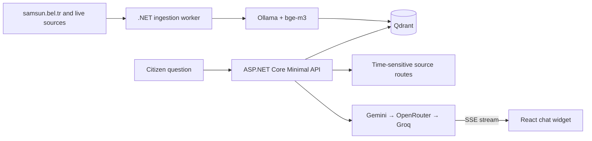

# Samsun Municipality — AI Information Assistant

> Independent RAG assistant that turns continuously collected municipal information into grounded, streamed answers for citizens.

> [!IMPORTANT]
> This is an independent portfolio project. It is **not an official product of Samsun Metropolitan Municipality** and does not represent the municipality.

This is a **documentation-only showcase**. The source code is private; a guided code walkthrough is available on request.

| Status | Knowledge flow | Stack |
| --- | --- | --- |
| Working prototype | Automated collection → local embeddings → Qdrant retrieval → streamed answer | .NET, Qdrant, Ollama, React |

## The problem

Municipal information is distributed across news, announcements, service pages and time-sensitive sources. Citizens may know the question they want to ask without knowing which department or page holds the answer.

The project explores how retrieval-augmented generation can provide a clearer entry point while still refusing unsupported answers and directing people to official channels.

## My role

I built the complete flow: scraper, chunking and embedding pipeline, Qdrant integration, query routing, provider fallback, SSE streaming and the React chat experience.

## System flow

## Core capabilities

- **Automated ingestion:** an hourly worker crawls news, announcements, events, services and other public content.
- **Local embeddings:** bge-m3 runs through Ollama, avoiding a paid embedding API.
- **Semantic retrieval:** the API embeds the question and searches Qdrant for relevant chunks.
- **Live-source routing:** time-sensitive categories such as on-duty pharmacies and service buildings bypass stale indexed answers.
- **Provider resilience:** Gemini, OpenRouter and Groq form an automatic fallback chain during rate limits or outages.
- **Streaming experience:** answers reach the React widget incrementally over Server-Sent Events.

## Grounding and safety

- Unsupported questions are refused instead of being answered from general model knowledge.
- The user is directed to official channels when the retrieved context is insufficient.
- Provider credentials are read from environment variables and never shipped to the browser.
- Public screenshots contain no private conversation or account data.

## Evidence available today

The project demonstrates the entire RAG delivery path—not only a chat interface—including automated ingestion, local embedding generation, vector retrieval, live-data routing, provider fallback and streamed output.

The repository intentionally does **not** claim an accuracy percentage without a documented evaluation set.

## Evaluation plan

A production-readiness study should use a repeatable question set and publish:

1. Retrieval Recall@K and source coverage.
2. Grounded-answer and correct-refusal rates.
3. Average and p95 end-to-end latency.
4. Content freshness and failed-ingestion counts.
5. Fallback frequency by LLM provider.
6. Accessibility and task-completion results with representative users.

## Screenshots

| Welcome | Quick-access card |
| --- | --- |
|  |  |

## Technology

| Component | Technology |
| --- | --- |
| Scraper | .NET 10 Worker Service |
| API | ASP.NET Core Minimal API, Server-Sent Events |
| Vector search | Qdrant |
| Embeddings | Ollama + bge-m3 |
| LLM providers | Google Gemini, OpenRouter, Groq |
| Frontend | React, TypeScript, Vite |

## Next steps

- Display inspectable source citations beside every answer.
- Automate retrieval and groundedness regression tests.
- Add ingestion health, content-freshness and provider dashboards.
- Validate the experience against real citizen tasks and accessibility requirements.

## Privacy and ownership

The screenshots and documentation are shared for portfolio review only. See [LICENSE.md](LICENSE.md).

© Mert Olgun. All rights reserved.
