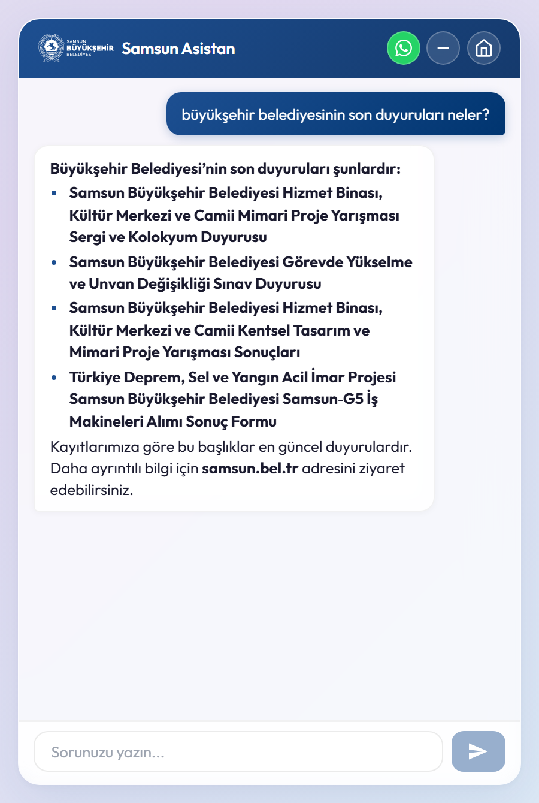
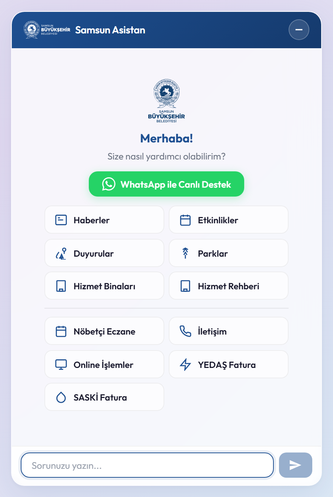
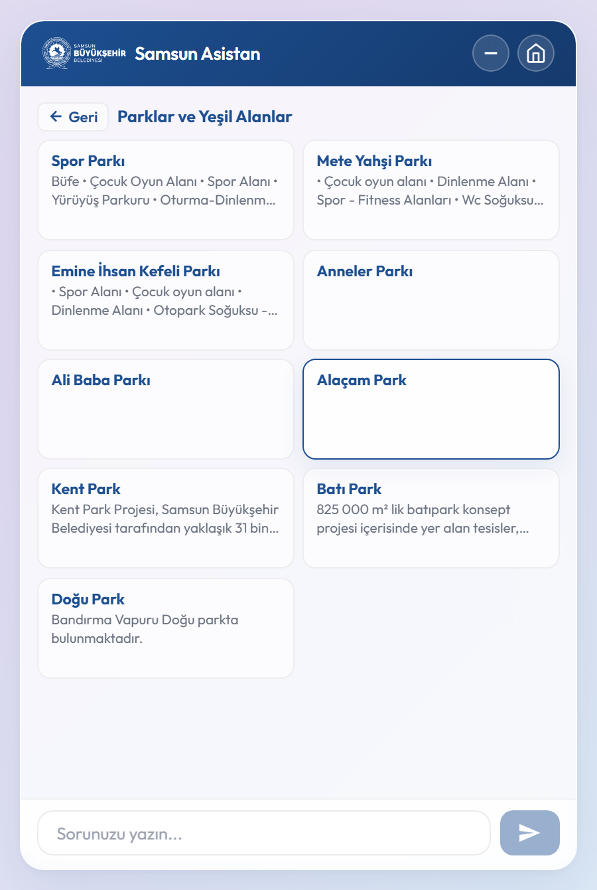

# Samsun Municipality — AI Information Assistant

> **Showcase repository.** The source code of this project is private. This repository contains only documentation and screenshots. Code walkthroughs are available on request.

An end-to-end **RAG (Retrieval-Augmented Generation)** assistant. It answers citizens' natural-language questions about Samsun Metropolitan Municipality from data that is collected automatically from the municipality's public website and kept up to date.

<p align="center"></p>

## How it works

```
 samsun.bel.tr ──► Scraper (.NET Worker, hourly sync)
                       │ chunk + embed (Ollama · bge-m3, runs locally)
                       ▼
                    Qdrant vector DB
                       ▲
 User question ──► Chatbot API (ASP.NET Core Minimal API)
                       │ 1. embed the query → semantic search in Qdrant
                       │ 2. live sources for time-sensitive data (on-duty pharmacies, service buildings, parks)
                       │ 3. LLM chain with automatic fallback: Gemini → OpenRouter → Groq
                       ▼  streamed answer (SSE)
                    React chat widget
```

## Highlights

- **Automated ingestion.** A background worker crawls the municipality's news, announcements, events, services and more. It chunks and embeds the content, then syncs Qdrant every hour.
- **Local embeddings.** Embeddings are produced by `bge-m3` running on Ollama, so no paid embedding API is required.
- **Multi-provider LLM fallback.** If one provider is rate-limited or down, the next one in the chain answers automatically. Keys are loaded only from environment variables.
- **Grounded answers.** When the retrieved context doesn't support an answer, the assistant says so and points the user to the official channels instead of making something up.
- **Streaming UI.** Answers stream in token by token (SSE). The widget also has quick-access cards for news, events, parks, service buildings, on-duty pharmacies and bill payment links.

## Tech stack

| Component | Technology |
| --- | --- |
| Scraper | .NET 10 Worker Service |
| API | ASP.NET Core Minimal API, Server-Sent Events |
| Vector search | Qdrant |
| Embeddings | Ollama + bge-m3 |
| LLMs | Google Gemini, OpenRouter, Groq (fallback chain) |
| Frontend | React, TypeScript, Vite |

## Screenshots

| Welcome | RAG answer | Quick-access card |
| --- | --- | --- |
|  |  |  |

---

This is an independent project and is not an official product of Samsun Metropolitan Municipality.
© Mert Olgun. All rights reserved.
